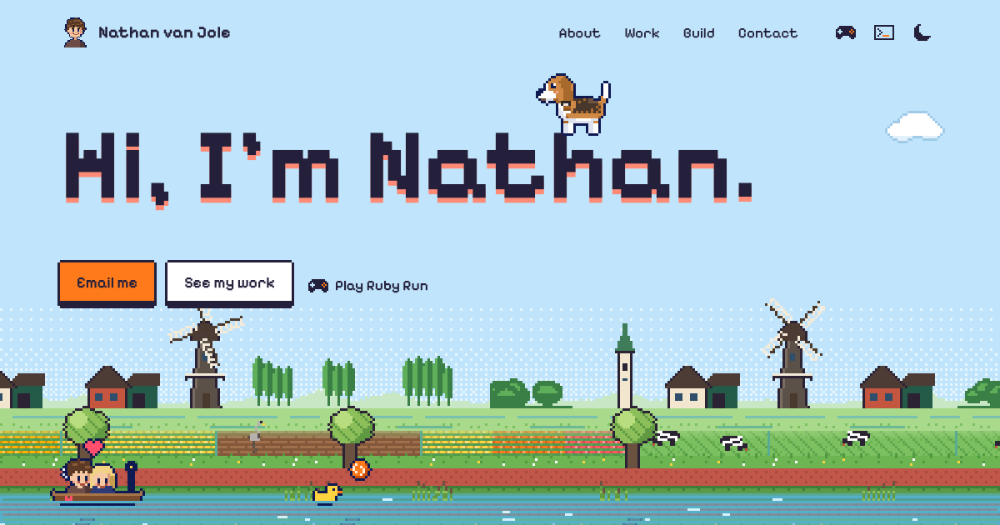
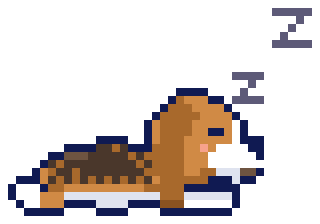

<p align="center">
  <a href="https://nathanvj.com">
    
  </a>
</p>

<h1 align="center">nathanvj.com</h1>

<p align="center">
  A one-page portfolio in colourful pixel art, set in a Dutch polder, starring <b>Ruby</b> the beagle.
  <br><br>
  <a href="https://nathanvj.com"><b>Visit the site</b></a>
  &nbsp;·&nbsp; <a href="https://advey.ai">Advey</a>
  &nbsp;·&nbsp; <a href="https://www.linkedin.com/in/nathan-van-jole">LinkedIn</a>
  &nbsp;·&nbsp; <a href="https://twitter.com/nathanvanjole">X</a>
</p>

<br>

Ruby walks over the page, fetches the ball, begs for treats, and has a small game with
achievements and hidden bones. There is a ditch with a duck, a boat for date night, a
terminal for the curious, and **Ruby Run**: an endless runner played right in the hero,
where the polder starts scrolling and Ruby runs down the bike path.

Built with [Astro](https://astro.build): one static HTML page, a little CSS, and one
JavaScript bundle that brings it to life. Without JavaScript the page is complete, just still.

**Stack:** Astro 7, TypeScript, plain CSS, canvas. No UI framework, no tracking, fonts self-hosted.

## Things to try

| | |
| --- | --- |
| **Throw the ball** | Drag it and let go. Ruby fetches. You can pick her up too. |
| **Pet Ruby** | Wiggle the cursor over her. |
| **Walk her** | <kbd>←</kbd> <kbd>→</kbd> or <kbd>A</kbd> <kbd>D</kbd>. Click her first for <kbd>↑</kbd> <kbd>↓</kbd> and <kbd>Space</kbd>. |
| **Play Ruby Run** | "Play Ruby Run" in the hero, or the gamepad in the header. Jump with <kbd>Space</kbd>, hold for higher, jump again in the air, duck with <kbd>↓</kbd>. |
| **Open the terminal** | The icon in the header, then type `help`. |

There's more. It's in the spoilers at the bottom.

## Quick start

Needs Node 22.12 or newer.

```sh
npm install
npm run dev       # http://localhost:4321, reloads as you edit
npm run build     # type-checks, then writes the site to dist/
npm run preview   # serves dist/ locally, to check the real build
```

## Deploy

Every push to `main` builds the site and publishes it to GitHub Pages
([`.github/workflows/deploy.yml`](.github/workflows/deploy.yml)). The build type-checks
first, so a type error stops the deploy instead of shipping.

The domain lives in two places that should match: the repo's Pages settings (custom
domain) and `site` in `astro.config.mjs` (for canonical URLs and link previews). `dist/`
is plain static files, so any other static host works too.

## Changing text

All text lives in **`src/content/`**. You never need to touch a component to change words.

| File | What's in it |
| --- | --- |
| `site.ts` | Name, email, socials, menu, browser title and description, the footer |
| `home.ts` | Every section top to bottom: hero, about, work, what I build, contact |
| `ruby.ts` | What Ruby says, her game (achievements, bones, panel labels), the terminal |
| `run.ts` | Ruby Run: every word in the game, the milestones, the bones goal |
| `types.ts` | The shapes of the above, only needed when adding a new kind of thing |

Text marked `Rich` supports two bits of markup: `[link text](https://url)` and `**bold**`.
A few strings have `{placeholders}`, like `'Bone {n} of {total}'`; keep those words in braces.

<details>
<summary><b>Common edits</b></summary>

<br>

- **Add or change a job**: add an entry to `work.entries` in `home.ts`. Logos are tiny
  pixel PNGs in `public/img/logos/` (shown at their native size times the page pixel);
  you can also use `{ portrait: true }` (the pixel Nathan) or `{ icon: 'cap' }`.
- **Give Ruby a hat on a card**: add `hat: { name: 'crown', says: 'Boss mode.' }` to that
  job. Hats: `cap`, `hardhat`, `crown`, `party`.
- **What Ruby says somewhere**: `rubySays` on a section or job. Her own lines are in `ruby.ts`;
  a line can be a list, then she picks one at random.
- **Achievements**: `game.achievements` in `ruby.ts`. The game awards them by `id`
  (see `scripts/game/game.ts`); add a `secret` text to hide one until it's found.
- **Hidden bones**: each id in `game.bones` needs a `<Bone id="…" />` in a component,
  except `terminal`, which is found in the terminal.
- **Ruby Run**: texts, the crash lines and the milestones ("Past the Westerkerk!") are in
  `run.ts`. How hard it gets is in code: the speed in `scripts/run/course.ts` (`speedAt`),
  which obstacles show up from which distance (the `all` list in `Course.next`), and the
  jump and the sky turning along the run in `scripts/run/engine.ts` (`PHYS`, `SKY`).

</details>

## How it's built

```
src/
  content/        all text and settings (see above)
  layouts/        Base.astro: <head>, fonts, global styles, theme before first paint
  pages/          index.astro: the one page, composed from sections
  components/
    layout/       Header, Footer
    sections/     Hero, About, Work, Build, Contact
    ui/           PixelIcon, Bone, PetPanel, Terminal, RubyRun, Toast
  styles/         tokens, base, the pixel kit, overlays (see "Styles")
  lib/rich.ts     the tiny markup used in content, and {placeholder} filling
  scripts/        everything that moves (see "Scripts")
public/           images, logos, favicon, the link preview image
```

### Layers

Each layer only knows about the ones below it:

```
content          words and settings, plain data
  ↓
components       markup and styles, rendered at build time (no JavaScript)
  ↓
scripts/main.ts  boots everything on the page
  ├─ ui/         theme, terminal, toasts, small interactions
  ├─ game/       moods, levels, achievements, bones, Ruby's panel
  ├─ run/        Ruby Run: the endless runner in the hero
  ├─ mascot/     Ruby, the ball and treats, the page as her world
  ├─ scene/      the painted polder, the tulips, the mailbox corner
  └─ pixel/      palette, pixel buffer, sprites and icons (no page knowledge at all)
```

The engines never call the game or the UI. They announce what happened on a small
event bus (`scripts/events.ts`: `ruby`, `water:duck`, `water:boat`, `theme`,
`terminal:open`, `run:over`), and whoever cares listens. That's how the game awards
achievements without Ruby knowing a game exists.

### Scripts

- **`pixel/`**: drawing at native resolution. `PixelBuffer` holds palette indices,
  draws simple shapes, adds a 1px outline and becomes a canvas. Ruby (`ruby.ts`) is a
  rig, not a sprite sheet: `drawRuby(buffer, pose)` paints her for any pose, so walking,
  squash and stretch, eye tracking, wagging and hats are just numbers. Icons are text
  templates turned into inline SVG, usable at build time and in the browser.
- **`scene/`**: the hero landscape. `landscape.ts` paints the sky, the red bike path Ruby
  walks on and the ditch in front of it, and animates clouds, stars, water, Kwak the duck
  and the boat at 12 fps. The duck and the boat are on a second canvas above Ruby, because
  they float in the water between her path and you. `polder.ts` is everything on the land,
  in layers that scroll at different speeds: a hazy tree line, windmills with turning
  sails, farms and a church on the horizon, bulb fields, meadows with cows that wander and
  graze, a heron, the verge with pollard willows, geese flying over, reeds along the water.
  It is generated as it comes into view, so it can scroll forever: that is what Ruby Run
  does with it. The colours of the painted world (day and night) are in `env.ts`.
  `props.ts` paints the smaller pieces: the tulips in the footer and the corner of a field
  by the contact form (measured in `postbox.ts`), whose letter you can post into the mailbox.
- **`mascot/`**: `Ruby` is a small state machine. Modes are what she is doing (idle, walk,
  sniff, run, jump, sit, sleep…); tasks span several modes (fetch the ball, eat a treat,
  zoomies). `PageWorld` turns every `[data-platform]` element into a one-way platform
  she can stand on, owns the ball, and handles input: dragging, throwing, petting
  (wiggle the cursor over her) and the keyboard (<kbd>←</kbd> <kbd>→</kbd> and
  <kbd>A</kbd> <kbd>D</kbd> always; <kbd>↑</kbd> <kbd>↓</kbd> and <kbd>Space</kbd> after
  clicking her, so page scrolling keeps working).
- **`game/`**: moods drift down over time (also while you're away), and change how Ruby
  behaves: hungry means begging, tired means naps, very happy means zoomies. Progress is
  saved in `localStorage`, per visitor.
- **`run/`**: Ruby Run, played in the hero. `course.ts` generates what comes her way, by
  distance, so a slow frame never changes the course: bike-path posts, bikes, tulip
  planters, pigeons to duck under and cyclists riding at her, faster and in trickier
  combinations as the metres add up. She can jump, hold for higher, jump once more in the
  air, and duck. `engine.ts` is the loop: it scrolls the polder, turns its sky from day to
  night (or back), and draws the obstacles, bones and Ruby on the hero canvas. `play.ts`
  is everything around it: the scoreboard that takes the place of the hero buttons
  (`RubyRun.astro`), keyboard and touch, the best score, sharing, and the header and hero
  following the game's sky (`data-sky`, see "Styles"). It pauses when the hero scrolls out
  of view and stops once it's gone; the page's Ruby then stands on the path where she
  stopped running. When a run ends it emits `run:over`, and the game hands out the three
  Ruby Run achievements. Start it from "Play Ruby Run" in the hero, the gamepad in the
  header, Ruby's panel, or `play` in the terminal.

### Making something walkable

Add `data-platform` to any element. Ruby stands on its top edge. Optional:

| Attribute | Effect |
| --- | --- |
| `data-platform-offset="0.16em"` | moves the standing line down (px or em) |
| `data-platform="fixed"` | for `position: fixed` elements, like the terminal |
| `data-say="…"` | what she might say when she lands there |
| `data-hat="crown" data-hat-says="…"` | a hat she puts on there |

Headings wrap their text in a `<span data-platform>`, so she stands on the words, not the
whole row.

## Styles

- `styles/tokens.css`: **the only place** for colours (day and night), fonts, the pixel
  size `--px` (3px, 2px on phones) and the stacking layers (`--z-*`). If two things
  overlap, they each use one of these layers. An element with `data-sky="day"` or
  `data-sky="night"` gets that sky's colours whatever the page theme is.
- `styles/base.css`: reset, typography, the page container.
- `styles/pixel.css`: the pixel kit: `.tile`, `.btn`, `.chip`, `.badge`. Borders and the
  tile "thickness" are box-shadows on the pixel grid.
- `styles/overlays.css`: what scripts add on top: Ruby, the ball, speech bubbles, confetti,
  and what steps aside while Ruby Run is on (`:root[data-run]`).
- Section styles live in their component (Astro scopes them).

**Design rules, in short:** the painted world is a colourful Dutch polder (green meadows,
bulb fields, brick farms, a red bike path, a teal ditch); the page around it stays calm,
with warm ink, white tiles and sunny yellow for the small details; Dutch orange always
means "do this". Everything sits on one pixel grid, sprites only scale by whole numbers,
and the page must read fine without touching any of the play.

| | Colour | Role |
| --- | --- | --- |
|  | `#24203b` ink | Text, outlines, dark backgrounds |
|  | `#eef7fc` glaze | The page |
|  | `#bfe4fb` sky | The polder sky |
|  | `#ff7a1a` Dutch orange | The one thing to do |
|  | `#f6c453` sunny yellow | Small details |
|  | `#ff8a75` coral | The shadow under pixel headlines |
|  | `#1f74c8` cobalt | Links |

Type: **Pixelify Sans** for display, **Figtree** for everything else, **VT323** in the terminal.

## Good to know

- **Reduced motion**: if the visitor's system asks for it, the polder stands still and
  Ruby only moves when someone interacts with her.
- **Fonts** are self-hosted (`@fontsource`), so no requests to Google.
- **Storage keys**: `nathanvj:theme`, `nathanvj:ruby` (the game), `nathanvj:ruby-hidden`,
  `nathanvj:run` (Ruby Run's best score). Clear them to start fresh. Nothing is sent anywhere.
- **Testing Ruby Run**: in `npm run dev` the engine is `window.__run` in the console, e.g.
  `__run.zoom = 4` for zoomies.
- `public/og.png` (link previews, and the image at the top of this file) and
  `public/favicon.png` are screenshots of the site itself; regenerate them when the hero
  changes a lot.

<details>
<summary><b>Spoilers: the easter eggs</b></summary>

<br>

- The Konami code, or `party` in the terminal.
- Click the duck.
- Click the heart in the footer.
- In the terminal: `ls -a`, then `cat .bone`.

</details>

<br>

<p align="center">
  
  <br>
  <sub>Made in the Netherlands, with Ruby and ♥</sub>
</p>
